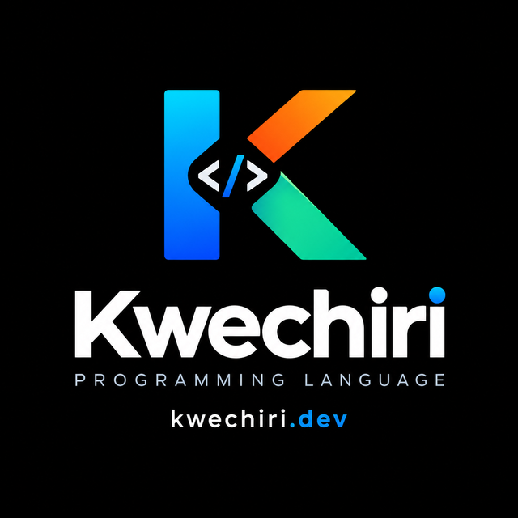

# Kwechiri

<p align="center">
  
</p>

Kwechiri is an Igbo-first programming language designed to make programming
more accessible to Igbo speakers while maintaining a coherent, professional
language and compiler architecture.

The compiler is currently implemented in TypeScript, generates JavaScript, and
uses an injected Kwechiri runtime with Node.js as its first host. Kwechiri source
files use the `.kwe` extension.

## Current status

Language Milestones 0–10 and the post-milestone Lexical Foundations, Core
Values & Logic, Collections, Functions, and Control Flow phases are closed.
Modules and the pre-1.0 Language Foundations phase are closed. Standard Library
Batches 11A, 11B, and 11C are certified and closed. The browser playground and
VS Code support milestones, Batches 12A, 12B, and 13, are also certified and
closed.

Kwechiri 1.1.0 is the current release. The
[Milestone 14 contract](docs/roadmap/MILESTONE-14-KWECHIRI-1.0.md) closed 1.0,
and [Milestone 15](docs/roadmap/MILESTONE-15-STANDARD-LIBRARY-11C.md) adds the
Batch 11C string functions. The CLI is published on npm, and the VS Code
extension is public in the Marketplace.
The implemented language includes:

- Unicode Igbo identifiers and located diagnostics
- strings, numbers, booleans, variables, arithmetic, and comparisons
- `bipụta`, `ọ bụrụ`/`ọzọ`, `mgbe`, `kwụsị`, and `gaa n'ihu`
- named `ọrụ` functions with `laghachi`
- homogeneous arrays and typed objects
- named relative modules using `webata`, `bupụ`, and `site na`
- nine explicit string functions imported from `kwechiri:eriri`
- an explicit runtime boundary with a Node.js implementation
- a public VS Code extension for `.kwe` syntax highlighting and diagnostics

## Quick start

Requires Node.js 20 or newer.

Install the current release:

```sh
npm install --global kwechiri@1.1.0
kwechiri hello.kwe
```

```sh
npm install
npm run build
node dist/cli/index.js hello.kwe
```

Expected output:

```text
Ndewo Ụwa!
```

After linking the package locally with `npm link`, run a program with either
the compatible shorthand or the explicit command:

```sh
kwechiri hello.kwe
kwechiri run hello.kwe
```

Validate without executing, or compile directly runnable Node.js output:

```sh
kwechiri check hello.kwe
kwechiri compile hello.kwe
node hello.js
kwechiri compile hello.kwe --out build/hello.js --force
```

The parent of an explicit output path must already exist. Compilation refuses
to overwrite by default. See the [CLI specification](docs/language-spec/cli.md)
for help, version, streams, exit codes, and generated-artifact requirements.

## Example

```kwe
ọrụ gbakọọ(a, b) {
    laghachi a + b
}

nsonaazụ = gbakọọ(10, 20)
ọ bụrụ (nsonaazụ >= 30) {
    bipụta("Nsonaazụ zuru oke")
}
```

Additional executable examples are available in [`examples/`](examples/).

## Development

Install the locked dependencies and run the canonical quality gate:

```sh
npm ci
npm run check
```

The gate covers linting, strict source and test type checking, all tests, and a
production build. See the [development workflow](docs/development/workflow.md)
and [testing guide](docs/development/testing.md).

The static public website lives in [`website/`](website/). Install its locked
dependencies and validate it separately:

```sh
npm ci --prefix website
npm run website:check
```

The VS Code integration lives in [`extensions/vscode/`](extensions/vscode/).
Install its locked dependencies, validate it, and produce a local VSIX:

```sh
npm ci --prefix extensions/vscode
npm run vscode:check
```

The build command does not publish. The released extension is available from the
[VS Code Marketplace](https://marketplace.visualstudio.com/items?itemName=kwechiri.kwechiri-language).

## Documentation

- [Official website](https://kwechiri.dev/)
- [Documentation index](docs/README.md)
- [Current language specification](docs/language-spec/README.md)
- [Changelog](CHANGELOG.md)
- [Architecture index](docs/architecture/README.md)
- [Design-decision index](docs/design-decisions/README.md)
- [Project status and roadmap](docs/roadmap/PROJECT-STATUS.md)
- [Recorded technical debt](docs/roadmap/technical-debt.md)
- [Website foundation plan](docs/roadmap/WEBSITE-FOUNDATION-PLAN.md)
- [VS Code support contract](docs/roadmap/MILESTONE-13-VS-CODE.md)
- [Contributing guide](CONTRIBUTING.md)
- [Code of conduct](CODE_OF_CONDUCT.md)
- [Security policy](SECURITY.md)
- [Third-party notices](THIRD_PARTY_NOTICES.md)

Historical `milestone-*.md` files remain available as incremental records and
may be superseded by the current topic-oriented specification and later ADRs.

## License and publication

Kwechiri is licensed under the MIT License. See [`LICENSE`](LICENSE) for the
full text and copyright notice.

The compiler package is published on npm as `kwechiri@1.1.0`. The separate VS
Code extension is publicly distributed through the Visual Studio Marketplace.
At the time of this release preparation, the GitHub source repository is
private; repository publication is a separate owner-controlled decision.
